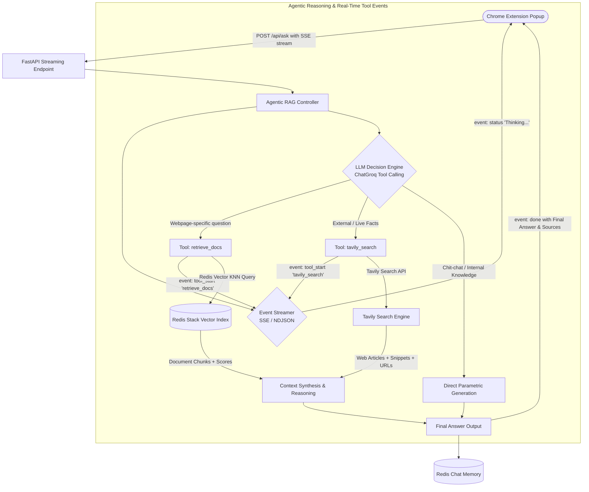
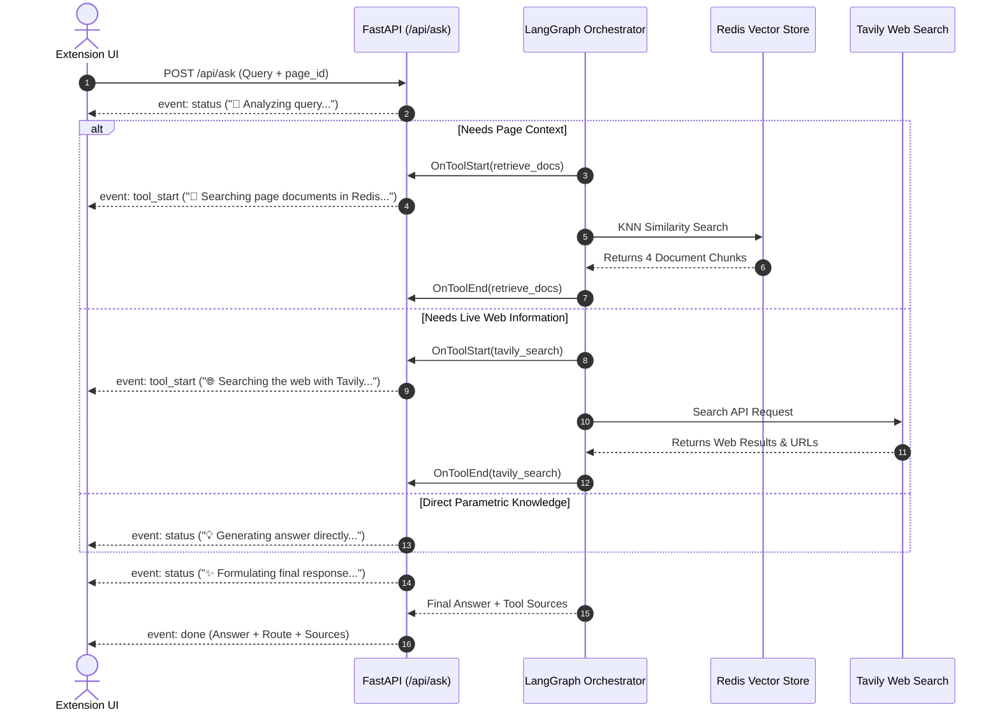
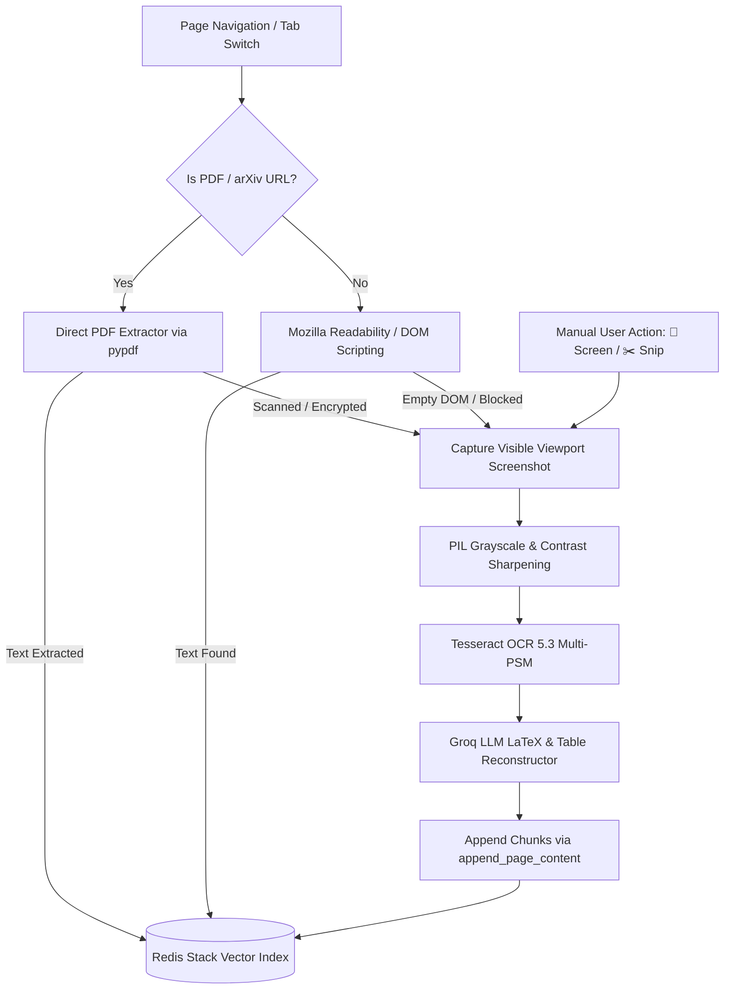

# Architecture Specification: Agentic RAG with Dynamic Tool Routing & Live Orchestrator Status

## 1. Overview & Objectives

The objective is to transform the existing linear PageIntel RAG pipeline into an **Agentic RAG System** featuring:
1. **Dynamic Tool Routing**: An LLM-powered orchestrator autonomously chooses between:
   - **`retrieve_docs`**: Local Redis Vector Store search over active webpage chunks.
   - **`tavily_search`**: Live web search via LangChain's Tavily integration for current events and external topics.
   - **Direct Generation**: Direct answer from parametric knowledge (greetings, logic, math, formatting) without invoking external tools.
2. **Real-Time Orchestrator Status Feedback**: Streaming live tool execution state to the user (e.g., *"Thinking..."*, *"Searching page documents..."*, *"Searching the web with Tavily..."*, *"Synthesizing answer..."*) so the user always knows what the system is doing while waiting.
3. **Minimalist, De-cluttered Frontend**: Removing technical clutter (raw UUID dumps, extracted text preview accordions, chunk/word counters) in favor of a sleek, clean, conversation-first interface.

---

## 2. High-Level System Architecture



---

## 3. Real-Time Tool Orchestration & Progress Feedback

To ensure the user is not left staring at a static loader, the orchestrator streams live status updates during execution:

### 3.1. Orchestration Event Lifecycle



### 3.2. Event Protocol (Server-Sent Events / Streaming JSON)

| Event Type | Payload Example | UI Display in Extension |
| :--- | :--- | :--- |
| `status` | `{"message": "Analyzing question..."}` | 🧠 *Analyzing question...* |
| `tool_start` (`retrieve_docs`) | `{"tool": "retrieve_docs", "message": "Searching page content in Redis..."}` | 📄 *Searching page documents in Redis...* |
| `tool_start` (`tavily_search`) | `{"tool": "tavily_search", "message": "Searching live web with Tavily..."}` | 🌐 *Searching live web with Tavily...* |
| `status` | `{"message": "Formulating final response..."}` | ✨ *Synthesizing answer...* |
| `done` | `{"answer": "...", "route_taken": "document", "sources": [...]}` | Bubble renders answer + route badge + sources drawer |

---

## 4. Minimalist Frontend Redesign

The user interface is refined to remove redundant debug information and spotlight the conversation and active tool progress:

### 4.1. Elements Removed (De-cluttering)
- ❌ **Extracted Content Accordion (`#context-accordion`)**: Removed the debug section that displayed the full text dump and raw UUID.
- ❌ **Technical Counters (`#stat-chunks`, `#stat-words`)**: Removed "0 Chunks" and "0 words" from the top bar.
- ❌ **Verbose Welcome Card**: Removed long technical descriptions mentioning Redis Docker setup.

### 4.2. Refined, Minimal UI Components
- **Top Bar**: Minimal breadcrumb featuring the current site favicon/domain and truncated page title, plus a subtle status dot (`Connected` / `Active`).
- **Clean Welcome Message**: Short, friendly card:
  > *"Ask anything about this page or general questions — I'll automatically retrieve page context or search the web when needed."*
- **Compact Prompt Chips**: Sleek, horizontal pill suggestions (e.g. *Summary*, *Key Takeaways*, *Explain Simply*).
- **Dynamic Live Tool Indicator**: Inside the chat container during queries, the typing indicator updates dynamically with icon and text matching the active tool:
  - 📄 *Searching page documents...*
  - 🌐 *Searching web with Tavily...*
  - ✨ *Synthesizing response...*
- **Sleek Source Citations**: A compact, collapsible pill under the assistant answer:
  - `📄 3 Page Chunks` (for document retrieval)
  - `🌐 4 Web Sources` (with clickable links and domain names)
  - Hidden for direct generation.
- **Settings Drawer**: Retains essential configuration (Backend URL, Groq API Key, Groq Model, Tavily API Key) in an organized, clean modal.

---

## 5. Tool Specifications & Routing Matrix

### 5.1. Routing Matrix

| Route | Trigger Conditions | Example User Prompts | Data Provider |
| :--- | :--- | :--- | :--- |
| **`retrieve_docs`** | Questions specifically regarding the active webpage, its article, details, numbers, or topics on page. | *"What is this article arguing?", "Summarize the pricing table on this page", "What did the author say about Redis?"* | Redis Vector Index (`pageintel:doc:{page_id}:*`) |
| **`tavily_search`** | Real-world facts, current events, competitor research, or information not found on the page. | *"What are the latest developments in AI this week?", "Who won the game yesterday?", "Compare this tool with alternative open-source projects."* | Tavily Search via LangChain |
| **`direct_answer`** | Chit-chat, conceptual explanations, math, translations, code snippets, or formatting prior conversation. | *"Hi! Can you write a haiku about computers?", "Explain how neural networks learn", "Format your previous response as JSON."* | LLM Parametric Weights (Zero Tools) |

### 5.2. Tool Definitions

```python
from langchain_core.tools import tool
from langchain_community.tools.tavily_search import TavilySearchResults
from typing import Optional, List, Dict, Any

@tool
def retrieve_docs(
    query: str,
    page_id: str,
    top_k: int = 4,
    score_threshold: Optional[float] = None
) -> List[Dict[str, Any]]:
    """Retrieve relevant semantic chunks from the currently indexed webpage in Redis.

    Args:
        query: Semantic query or search terms describing the information needed from the page.
        page_id: Unique persistent identifier of the active webpage.
        top_k: Number of most relevant document chunks to return (default: 4).
        score_threshold: Optional cosine distance cutoff.
    """
```

```python
def get_tavily_tool(api_key: Optional[str] = None, max_results: int = 5):
    """Instantiate Tavily web search tool with API key fallback."""
    key = api_key or os.getenv("TAVILY_API_KEY")
    return TavilySearchResults(
        api_key=key,
        max_results=max_results,
        search_depth="advanced",
        include_answer=True,
        include_raw_content=False,
        name="tavily_search",
        description="Search the live web for recent information, external facts, or topics not present on the current page."
    )
```

---

## 6. Implementation Roadmap

1. **Backend Dependencies**:
   - Install `tavily-python` and `langchain-community` in `.venv`.
   - Add `TAVILY_API_KEY` to `backend/.env`.

2. **Agentic Workflow Module (`backend/agentic_rag_wf.py`)**:
   - Define `retrieve_docs` and `tavily_search` tools.
   - Build LangGraph `StateGraph` agent with tool node, router node, and callback streamer.
   - Implement async generator `answer_query_stream(...)` emitting progress events (`status`, `tool_start`, `tool_end`, `done`).

3. **FastAPI Endpoints (`backend/main.py`)**:
   - Update `/api/ask` to support streaming response (`StreamingResponse` with SSE/NDJSON) as well as fallback standard JSON response.
   - Update request schema to accept optional `tavily_api_key`.

4. **Web Extension Minimal Redesign (`web-extension/popup.html` & `popup.js`)**:
   - Remove debug accordion and bulky statistic counters.
   - Update `appendThinkingIndicator` to listen for stream events and update status dynamically.
   - Add `tavily_api_key` input to Settings drawer.
   - Format source pills with distinctive tags: `📄 Page Chunks` vs `🌐 Web Citations`.

---

## 7. Vision OCR & Scientific Paper Ingestion Subsystem

To address scenarios where page text cannot be extracted through DOM scripting (e.g. Chrome's sandboxed native PDF plugin when reading arXiv papers, scanned books, or dynamic canvas apps), PageIntel employs a resilient multi-tier extraction pipeline:



### 7.1. Mathematical & Tabular Post-Processing
Raw OCR output often distorts mathematical superscripts, fractions, and Greek symbols. PageIntel feeds the raw character stream through Groq with a specialized system prompt that reconstructs equations into standard LaTeX:
- Inline formulas: `$ \text{Attention}(Q,K,V) $`
- Display blocks: `$$ \text{softmax}\left(\frac{QK^\top}{\sqrt{d_k}}\right)V $$`
- Tabular figures: Reformatted into Markdown comparison tables.

---

## 8. Containerized Deployment & Bridge Networking Architecture

The backend infrastructure is packaged using Docker and Docker Compose to guarantee zero environment drift:

```
  ┌────────────────────────────────────────────────────────┐
  │                 Host Machine (Your PC)                 │
  │                                                        │
  │   Chrome / Brave Browser                               │
  │   └── PageIntel AI Extension                           │
  │         │                                              │
  │         │ calls http://localhost:8000                  │
  │         ▼                                              │
  │   ┌────────────────────────────────────────────────┐   │
  │   │  Docker Bridge Network (web_extension_project) │   │
  │   │                                                │   │
  │   │  pageintel-backend (:8000)                     │   │
  │   │    • FastAPI + Tesseract 5.3 + pypdf           │   │
  │   │    • connects to redis://redis:6379            │   │
  │   │          │                                     │   │
  │   │          ▼                                     │   │
  │   │  redis-stack (:6379, :8001)                    │   │
  │   │    • Vector Index (pageintel_idx)              │   │
  │   │    • RediSearch + RedisJSON                    │   │
  │   └────────────────────────────────────────────────┘   │
  └────────────────────────────────────────────────────────┘
```

- **Container DNS Resolution**: The `backend` container resolves Redis directly via service hostname `redis://redis:6379`.
- **Host Port Forwarding**: Port `8000` is forwarded to `localhost:8000`, enabling the Chrome extension to query the backend seamlessly without cross-origin configuration or reverse proxies.

