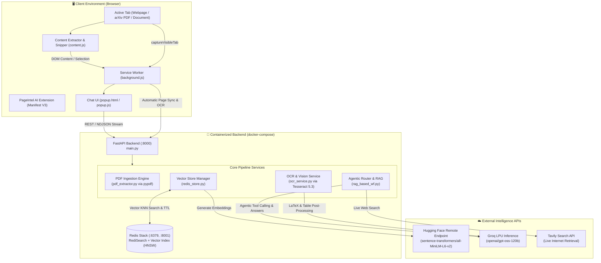
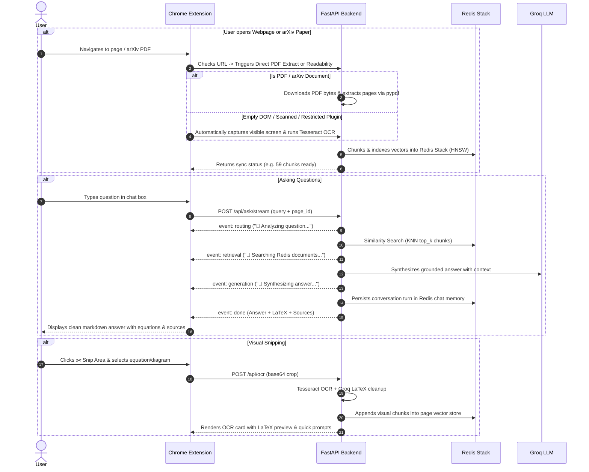

# 🧠 PageIntel AI — Redis Vector & Visual Copilot

<div align="center">


**An intelligent browser extension & containerized Agentic RAG backend that turns any webpage, arXiv research paper, or visual diagram into a real-time vector database powered by Redis Stack, Groq, and Tesseract OCR.**

[🚀 Quick Start](#-quick-start-with-docker) • [✨ Key Features](#-key-features) • [🏗️ Architecture](#️-system-architecture) • [🔄 Workflow](#-end-to-end-workflow) • [📖 Deep Dive Architecture](ARCHITECTURE.md) • [📡 API Reference](#-api-reference)

</div>

---

> 💡 **Architectural Deep Dive**:
> For the comprehensive engineering specification — including the LangGraph tool-routing state machine, memory TTL eviction algorithms, token budget trimming, and NDJSON streaming protocols — please refer to [**`ARCHITECTURE.md`**](ARCHITECTURE.md).

---

## ✨ Key Features

| Capability | Description |
| :--- | :--- |
| 📄 **Direct arXiv & PDF Ingestion** | Automatically detects arXiv links (`arxiv.org/abs/...`, `arxiv.org/pdf/...`) and standard `.pdf` URLs. Downloads the paper and extracts complete multi-page text using `pypdf`, chunking and indexing it directly into Redis. |
| 📸 **Automatic Visual OCR Backup** | When reading in Chrome's native PDF plugin, Canva, or canvas-rendered SPAs where the DOM text is unextractable, PageIntel **automatically takes a screenshot** and runs **Tesseract 5.3 OCR** so you **never go blank of data**. |
| ✂️ **1-Click Screen Capture & Snipping Tool** | Capture the entire visible screen or drag-and-drop a selection box around specific formulas, architecture diagrams, or benchmark tables. Uses Groq to clean up OCR noise and convert math into clean LaTeX (`$inline$` and `$$display$$`). |
| ⚡ **Redis Stack Vector Database (Docker)** | Chunks webpage text and stores 384-dimensional dense vectors using **RediSearch (HNSW, Cosine Distance)**. Features automatic 5-minute TTL eviction on page navigation to prevent memory bloat. |
| 🌐 **Agentic Dynamic Tool Routing** | Powered by Groq LLM tool calling. Dynamically routes queries between **`retrieve_docs`** (page vector search), **`tavily_search`** (live internet search for external facts), or **`direct_synthesis`** (internal reasoning). |
| 🌊 **Real-Time NDJSON Streaming** | Experience zero lag with live thinking indicators: *“Analyzing query...”* ➔ *“Searching Redis vectors...”* ➔ *“Synthesizing answer...”*. |

---

## 🏗️ System Architecture

PageIntel AI operates as a unified, dual-layer system combining a lightweight **Chrome Manifest V3 Extension** with a containerized **FastAPI + Redis Stack Backend**:



---

## 🔄 End-to-End Workflow



---

## 🚀 Quick Start with Docker

You can launch the entire stack (FastAPI Backend + Redis Stack Vector Database with Tesseract OCR) using a single command:

### 1. Prerequisites
- [Docker](https://docs.docker.com/get-docker/) & Docker Compose installed.
- Free API keys from [Groq Console](https://console.groq.com) and [Tavily](https://tavily.com) (optional).

### 2. Configure Environment
Copy the example environment file and add your keys:
```bash
cp backend/.env.example backend/.env
```
Edit `backend/.env`:
```env
# Required: Free key from https://console.groq.com
GROQ_API_KEY=gsk_your_groq_api_key_here
GROQ_MODEL=openai/gpt-oss-120b

# Optional: Remote Hugging Face token (works without token on free tier)
HF_TOKEN=

# Optional: Live Web Search Key from https://tavily.com
tavily_api_key=tvly-your_tavily_key_here

# Redis connection inside Docker network
REDIS_URL=redis://redis:6379
```

### 3. Start the Backend via Docker Compose
From the repository root:
```bash
docker compose up -d
```
Verify the services are healthy:
```bash
docker compose ps
curl http://localhost:8000/health
```
> **Output:**
> `{"status":"healthy","redis_connected":true,"vector_index":"pageintel_idx","tesseract_ocr":true,"pdf_support":true}`

* **FastAPI Backend**: `http://localhost:8000`
* **Redis Database**: `localhost:6379`
* **RedisInsight Visual GUI**: `http://localhost:8001` (explore keys, vectors, and TTLs visually in your browser)

### 4. Load the Extension in Your Browser (Chrome / Brave / Edge)
1. Open `chrome://extensions/`
2. Toggle on **Developer mode** (top-right).
3. Click **Load unpacked**.
4. Select the `web-extension/` directory from this project.
5. Pin **PageIntel AI** to your browser toolbar!

---

## 💻 Local Development (Without Docker)

If you prefer running Python directly on your host machine:

```bash
# 1. Start Redis Stack container
docker run -d --name redis-stack -p 6379:6379 -p 8001:8001 redis/redis-stack:latest

# 2. Setup Virtual Environment
python3 -m venv .venv
source .venv/bin/activate
pip install -r backend/requirements.txt

# 3. Ensure Tesseract is installed on your OS
# Ubuntu/Debian: sudo apt install tesseract-ocr tesseract-ocr-eng
# macOS: brew install tesseract

# 4. Start the FastAPI server
uvicorn backend.main:app --host 0.0.0.0 --port 8000 --reload
```

---

## 📡 API Reference

The backend exposes RESTful and streaming endpoints:

| Endpoint | Method | Description |
| :--- | :---: | :--- |
| `/health` | `GET` | Verifies Redis connectivity, vector index status, and OCR readiness. |
| `/api/extract_pdf` | `POST` | Fetches an arXiv paper or direct PDF URL, parses pages via `pypdf`, and chunks into Redis. |
| `/api/ocr` | `POST` | Accepts a base64 screenshot (or crop), runs Tesseract OCR + Groq LaTeX cleanup, and indexes text. |
| `/api/index_page` | `POST` | Indexes extracted HTML text. Automatically falls back to PDF extraction if URL is an arXiv paper. |
| `/api/ask` | `POST` | Synchronous RAG endpoint with dynamic tool calling (Redis docs vs Tavily web search). |
| `/api/ask/stream` | `POST` | Dedicated NDJSON streaming endpoint with real-time tool state transitions. |
| `/api/page_status/{id}` | `GET` | Inspects stored chunks, indexed status, and remaining TTL for an active page. |
| `/api/chat_history/{id}`| `GET` | Retrieves persisted multi-turn conversation memory for a page. |

---

## 📂 Project Structure

```
web_extension_project/
├── backend/
│   ├── main.py              # FastAPI server, endpoints, and CORS middleware
│   ├── rag_based_wf.py      # Agentic RAG router, Tavily integration & NDJSON streaming
│   ├── ocr_service.py       # Tesseract OCR 5.3 + PIL image enhancement + Groq LaTeX formatter
│   ├── pdf_extractor.py     # arXiv & standard PDF parsing with pypdf
│   ├── redis_store.py       # RediSearch HNSW vector store, chat memory & 5-min TTL manager
│   ├── hf_embeddings.py     # Remote Hugging Face Inference Endpoint embedding provider
│   ├── PROMPTS.py           # Structured prompts for routing, RAG synthesis & OCR cleanup
│   ├── Dockerfile           # Production container definition (Python 3.12-slim + Tesseract)
│   ├── requirements.txt     # Locked Python package dependencies
│   └── .env.example         # Template for environment variables
├── web-extension/
│   ├── manifest.json        # Chrome Extension Manifest V3 configuration
│   ├── background.js        # Service worker: URL tracking, screenshot capture & sync
│   ├── content.js           # Readability scraper, fallback DOM parser & interactive snipper
│   ├── popup.html           # Modern dark-mode chat UI with cropper modal & prompt chips
│   ├── popup.js             # Live NDJSON stream reader, OCR renderer & LaTeX formatting
│   └── icons/               # Extension icons (16px, 48px, 128px)
├── docker-compose.yaml      # Multi-service composition (Redis Stack + FastAPI Backend)
├── ARCHITECTURE.md          # Exhaustive architectural specification & engineering guide
└── README.md                # Project documentation
```

---

## 🔍 Deep Dive Reference

For detailed technical analysis of:
* The **LangGraph State Graph** and router edge conditions.
* Token budgeting and message windowing with summary fallback.
* Mathematical formula OCR recovery patterns.
* The 5-minute Redis key expiration protocol (`set_page_ttl`).

👉 **Read the full [ARCHITECTURE.md](ARCHITECTURE.md) document.**

---

<div align="center">

Made with ❤️ using **FastAPI**, **Redis Stack**, **Groq**, and **LangChain**.

</div>
